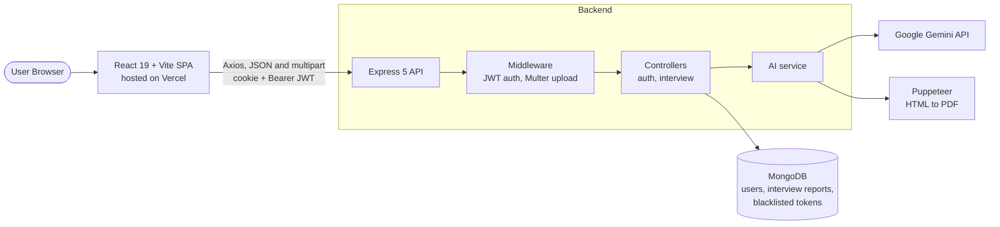
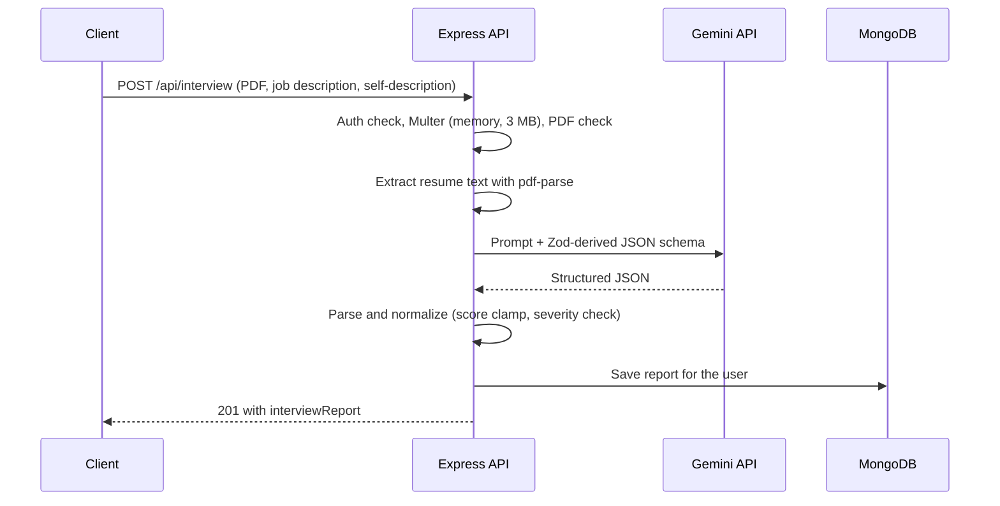

<div align="center">

# GapRoute AI

**Turn a job description and your resume into a personalized interview strategy.**

Upload your resume, paste a target job description, describe yourself, and get an AI-generated match score, skill gaps, interview questions with model answers, a day-wise preparation plan, and a tailored resume PDF.


[**Live Demo**](https://gaproute-ai-frontend.vercel.app/) · [**GitHub Repository**](https://github.com/Saksham-Parashar/gaproute-ai)

</div>

---

## Table of Contents

- [About the Project](#about-the-project)
- [Key Features](#key-features)
- [Technology Stack](#technology-stack)
- [System Architecture](#system-architecture)
- [Project Structure](#project-structure)
- [Installation and Setup](#installation-and-setup)
- [Environment Variables](#environment-variables)
- [API Documentation](#api-documentation)
- [AI Workflow](#ai-workflow)
- [Deployment](#deployment)
- [Project Status and Known Limitations](#project-status-and-known-limitations)
- [Author](#author)

---

## About the Project

GapRoute AI is a full-stack MERN application that helps job seekers prepare for a specific role. Instead of generic interview advice, it compares **your resume** and **your own description of your experience** against **the exact job description** you are targeting.

**The problem:** Candidates often don't know how well their profile fits a role, which skills they are missing, or what to prepare first.

**What GapRoute AI does:**

1. Reads your resume (PDF), the job description, and a short self-description.
2. Uses Google Gemini to produce a structured interview report for that role.
3. Saves each report to your account so you can reopen it later.
4. Optionally generates an ATS-friendly resume PDF tailored to the job description.

---

## Key Features

| Feature | Description | Status |
| --- | --- | --- |
| User authentication | Register, login, logout, and current-user lookup using JWT (httpOnly cookie, with Bearer-token fallback). Logged-out tokens are blacklisted server-side. | Implemented |
| Protected routes | Home and report pages redirect unauthenticated users to `/login`. | Implemented |
| Resume analysis | Upload a text-based PDF (max 3 MB). The server extracts the text and sends it to the AI. | Implemented |
| Job description analysis | The job description (required) is analyzed against the candidate profile. | Implemented |
| Self-description analysis | A required free-text description of experience, skills, and goals is included in the analysis. | Implemented |
| Match score | AI-generated score from 0 to 100, clamped and rounded by the server. | Implemented |
| Skill gap identification | A list of missing skills, each rated `low`, `medium`, or `high` severity. | Implemented |
| Interview questions | Technical and behavioral questions, each with the interviewer's intention and a suggested answer approach. | Implemented |
| Preparation roadmap | A day-wise plan with a focus area and tasks per day. | Implemented |
| Tailored resume PDF | AI generates resume HTML, which Puppeteer renders to an A4 PDF for download. | Implemented |
| Saved reports | Every report is stored in MongoDB and scoped to the logged-in user. | Implemented |
| Model fallback | If a Gemini model is unavailable or rate-limited, the server tries the next model in a fallback list. | Implemented |

---

## Technology Stack

| Layer | Technologies |
| --- | --- |
| **Frontend** | React 19, Vite 7, React Router 7, Axios, Sass (SCSS), ESLint |
| **Backend** | Node.js, Express 5, Multer (file upload), cookie-parser, CORS, dotenv |
| **Database** | MongoDB with Mongoose 9 |
| **AI integration** | Google Gemini via `@google/genai`, structured JSON output using Zod schemas (`zod`, `zod-to-json-schema`) |
| **PDF handling** | `pdf-parse` (read uploaded resumes), Puppeteer (generate resume PDFs) |
| **Authentication** | JSON Web Tokens (`jsonwebtoken`), password hashing with `bcryptjs`, token blacklist collection |
| **Deployment / services** | Frontend on Vercel (SPA rewrite in `vercel.json`), MongoDB database, Google Gemini API |

---

## System Architecture

The React single-page app talks to a REST API built with Express. The API authenticates requests, parses uploaded PDFs in memory, calls Gemini for structured output, and persists results in MongoDB.



**Request flow in short**

1. The browser sends credentials; the API returns a JWT, set as an httpOnly cookie and also returned in the response body.
2. The frontend sends the token on later requests (cookie, plus an `Authorization: Bearer` header from `localStorage`).
3. For a new report, the browser uploads a multipart form (resume PDF, job description, self-description).
4. The backend extracts the PDF text, asks Gemini for a structured report, stores it in MongoDB, and returns it.

---

## Project Structure

```text
gaproute-ai/
├── Backend/
│   ├── server.js                      # Entry point: loads env, connects to DB, listens on port 3000
│   ├── .puppeteerrc.cjs               # Puppeteer cache directory config
│   ├── package.json
│   └── src/
│       ├── app.js                     # Express app, CORS, routes, global error handler
│       ├── config/
│       │   └── database.js            # Mongoose connection
│       ├── controllers/
│       │   ├── auth.controller.js     # Register, login, logout, get-me
│       │   └── interview.controller.js# Generate/fetch reports, resume PDF
│       ├── middlewares/
│       │   ├── auth.middleware.js     # JWT verification + blacklist check
│       │   └── file.middleware.js     # Multer (memory storage, 3 MB limit)
│       ├── models/
│       │   ├── user.model.js
│       │   ├── interviewReport.model.js
│       │   └── blacklist.model.js
│       ├── routes/
│       │   ├── auth.routes.js
│       │   └── interview.routes.js
│       └── services/
│           └── ai.service.js          # Gemini calls, schemas, model fallback, Puppeteer PDF
└── Frontend/
    ├── index.html
    ├── vite.config.js
    ├── vercel.json                    # SPA rewrite to index.html
    ├── package.json
    └── src/
        ├── main.jsx / App.jsx         # App bootstrap and context providers
        ├── app.routes.jsx             # Route definitions
        ├── style.scss, style/         # Global styles
        └── features/
            ├── auth/                  # Login, Register, Protected route, auth context/hooks/API
            └── interview/             # Home (create plan), Interview (report view), context/hooks/API
```

---

## Installation and Setup

### Prerequisites

- **Node.js 20.19 or newer** (required by Vite 7) and npm
- A **MongoDB** instance (local, or a MongoDB Atlas connection string)
- A **Google Gemini API key**
- Internet access during backend install: the `postinstall` script downloads Chrome for Puppeteer (`npx puppeteer browsers install chrome`)

### 1. Clone the repository

```bash
git clone https://github.com/Saksham-Parashar/gaproute-ai.git
cd gaproute-ai
```

### 2. Set up the backend

```bash
cd Backend
npm install
```

Create a `Backend/.env` file (see [Environment Variables](#environment-variables)), then start the server:

```bash
npm run dev      # development, with nodemon
# or
npm start        # production-style start: node server.js
```

The API runs at **http://localhost:3000**. The port is currently hardcoded in `server.js`.

### 3. Set up the frontend

In a second terminal:

```bash
cd Frontend
npm install
npm run dev
```

Optionally create `Frontend/.env` (see below). The app runs at **http://localhost:5173**, which is the Vite default and the backend's default CORS origin.

### 4. Use the app locally

1. Open http://localhost:5173 and register a new account at `/register`.
2. On the home page, paste a job description, upload a resume PDF, and write a short self-description.
3. Click **Generate My Interview Strategy** and wait for the report page.

### Other frontend scripts

| Command | Purpose |
| --- | --- |
| `npm run build` | Production build |
| `npm run preview` | Preview the production build locally |
| `npm run lint` | Run ESLint |

---

## Environment Variables

Only variables actually read by the code are listed. Values below are placeholders, so never commit real secrets. Both `.env` files are git-ignored.

### Backend (`Backend/.env`)

| Variable | Required | Description | Example |
| --- | --- | --- | --- |
| `MONGO_URI` | Yes | MongoDB connection string | `mongodb://127.0.0.1:27017/gaproute-ai` |
| `JWT_SECRET` | Yes | Secret used to sign and verify JWTs | `replace-with-a-long-random-string` |
| `GOOGLE_GENAI_API_KEY` | Yes | Google Gemini API key | `your-gemini-api-key` |
| `CLIENT_URL` | Recommended | Allowed CORS origin (frontend URL). Defaults to `http://localhost:5173` | `http://localhost:5173` |
| `GEMINI_MODEL` | No | Overrides the first model tried. The remaining fallback models are defined in `MODEL_CHAIN` in `src/services/ai.service.js` | `your-preferred-gemini-model` |
| `NODE_ENV` | Production | When set to `production`, auth cookies use `secure: true` and `sameSite: "none"` (needed for a cross-site frontend/backend) | `production` |

### Frontend (`Frontend/.env`)

| Variable | Required | Description | Example |
| --- | --- | --- | --- |
| `VITE_API_URL` | Production | Base URL of the backend API. Defaults to `http://localhost:3000` | `https://your-backend.example.com` |

---

## API Documentation

Base path: `/api`. Protected routes require the JWT, sent either as the `token` cookie or as an `Authorization: Bearer <token>` header. Errors return JSON in the form `{ "message": "..." }`.

### Auth: `/api/auth`

| Method | Route | Auth | Description |
| --- | --- | --- | --- |
| `POST` | `/api/auth/register` | Public | Create an account. Body: `username`, `email`, `password`. Returns `201` with `token` and `user`. |
| `POST` | `/api/auth/login` | Public | Log in. Body: `email`, `password`. Returns `token` and `user`. |
| `GET` | `/api/auth/logout` | Public | Clears the cookie and blacklists the token if one is supplied. |
| `GET` | `/api/auth/get-me` | Required | Returns the current user (`id`, `username`, `email`). |

### Interview reports: `/api/interview`

| Method | Route | Auth | Description |
| --- | --- | --- | --- |
| `POST` | `/api/interview/` | Required | Generate a report. `multipart/form-data` with `resume` (PDF, max 3 MB), `jobDescription`, `selfDescription`. Returns `201` with `interviewReport`. |
| `GET` | `/api/interview/` | Required | List the user's reports, newest first. Returns a summary only (title, match score, timestamps), without questions, gaps, plan, or source text. |
| `GET` | `/api/interview/report/:interviewId` | Required | Get one full report belonging to the user. |
| `POST` | `/api/interview/resume/pdf/:interviewReportId` | Required | Generate and download a tailored resume PDF (`application/pdf`) for a report. |

**Validation and errors:** missing or non-PDF resume, empty job or self description, a PDF with no extractable text, and files over 3 MB return `400`. Missing or invalid tokens return `401`. A report that doesn't exist (or isn't yours) returns `404`.

---

## AI Workflow

All AI logic lives in `Backend/src/services/ai.service.js`.



**1. Input processing**
- The resume PDF is read from memory and converted to plain text with `pdf-parse`. Scanned, image-only PDFs are rejected because no text can be extracted.
- The resume text, self-description, and job description are combined into a single prompt.

**2. Model integration**
- Calls Google Gemini through `@google/genai` with `responseMimeType: "application/json"` and a response schema generated from a Zod schema.
- The schema defines `matchScore`, `technicalQuestions`, `behavioralQuestions`, `skillGaps`, `preparationPlan`, and `title`.
- **Model fallback:** the server tries each model in `MODEL_CHAIN` in order, moving on when a model returns retryable errors (such as 503, 429, or model-not-found). Other errors stop the chain and return a readable message.

**3. Output generation**
- The JSON response is parsed (stripping code fences if present) and normalized: score clamped to 0–100, severities restricted to `low` / `medium` / `high`, and missing arrays defaulted to empty.
- The report is saved to MongoDB together with the extracted resume text and both descriptions, linked to the user.

**4. Tailored resume PDF**
- A second Gemini call returns a single `html` field containing an A4 resume tailored to the job description.
- Puppeteer renders that HTML to a PDF, which is streamed back as a file download. The PDF is generated on request and is not stored.

---

## Deployment

| Part | Status |
| --- | --- |
| **Frontend** | Deployed on Vercel at [gaproute-ai-frontend.vercel.app](https://gaproute-ai-frontend.vercel.app/). `Frontend/vercel.json` rewrites all routes to `index.html` so client-side routing works on refresh. |
| **Backend** | A standalone Node.js server (`npm start`). The repository contains no host-specific config (no Dockerfile, Procfile, or `vercel.json` in `Backend/`). |
| **Database** | Any reachable MongoDB instance via `MONGO_URI`. |

**Configuration needed for a deployed setup**

1. **Backend:** set `MONGO_URI`, `JWT_SECRET`, `GOOGLE_GENAI_API_KEY`, `NODE_ENV=production`, and `CLIENT_URL` to the deployed frontend URL (for CORS).
2. **Frontend:** set `VITE_API_URL` to the deployed backend URL in the Vercel project settings.
3. **Cross-site cookies:** with `NODE_ENV=production`, cookies are `Secure` and `SameSite=None`, so the backend must be served over HTTPS.
4. **Puppeteer:** the backend host must be able to run headless Chrome. `postinstall` downloads Chrome into `Backend/.cache/puppeteer`, and the app launches it with `--no-sandbox`.
5. **Port:** the server listens on a fixed port, `3000`. Hosts that assign a port through `PORT` will need a small code change (see below).

---


## Author

**Saksham Parashar**

GitHub: [github.com/Saksham-Parashar](https://github.com/Saksham-Parashar)
